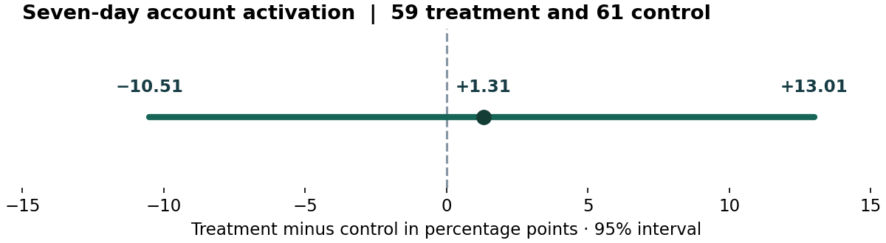
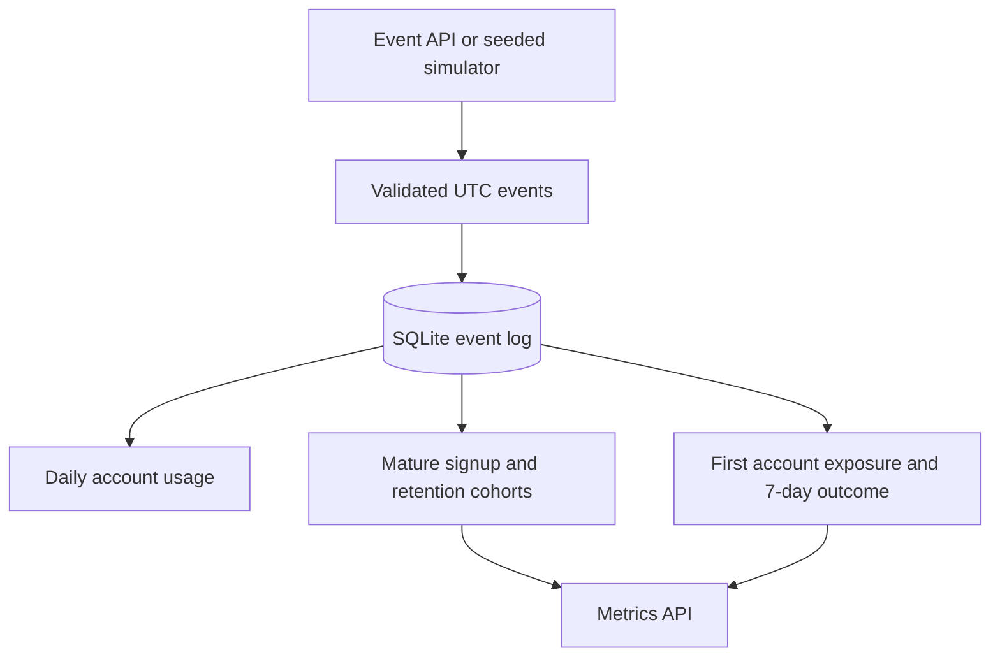

# B2B SaaS product intelligence

**Should we roll out guided onboarding?** A product manager needs to decide whether guided onboarding helps new accounts reach first value. This service turns retry-prone product events into a rollout readout with a defined denominator and a measure of uncertainty.

Across 120 synthetic accounts, 168 of 240 users completed onboarding within seven days. At the randomized account grain, 54/61 control and 53/59 treatment accounts activated. The difference was +1.31 percentage points, with a 95% interval from −10.51 to +13.01 points. **Defer rollout on this evidence.**



## Try it locally

Use Python 3.12 from the repository root. The demo generates its own synthetic inputs in a temporary directory and prints a decision readout.

```powershell
py -3.12 -m venv .venv
.\.venv\Scripts\python.exe -m pip install ".[dev]"
.\.venv\Scripts\python.exe scripts/demo.py
.\.venv\Scripts\python.exe -m unittest discover -s tests -v
```

On Linux or macOS, use `python3.12 -m venv .venv` and `.venv/bin/python` for the remaining commands. For the persistent example below, activate the environment first with `.\.venv\Scripts\Activate.ps1` in PowerShell or `source .venv/bin/activate` in Bash.

## Persistent example

```shell
product-simulate --db product_analytics.sqlite --accounts 120
product-metrics --db product_analytics.sqlite --as-of 2026-10-25
python -m uvicorn product_intelligence.api:app --port 8080
```

With the service running, open [the interactive API contract](http://127.0.0.1:8080/docs). The same database supplies the simulator and server when started from the repository root. Inspect [the October cohort readout](docs/cohort-readout.json).

```powershell
Invoke-RestMethod 'http://127.0.0.1:8080/v1/metrics?as_of=2026-10-25'
```

## Architecture and methodology



The ordered user funnel counts signup, first qualifying completion and subsequent meaningful use within the same seven-day signup window. A signup is unique per account and user. Weekly active accounts count a meaningful feature event in the last seven UTC dates. Week-two retention counts accounts with activity in days 7–13 after their first signup. The experiment counts any onboarding completion within seven days of first exposure, once per account. It reports a Newcombe difference interval from two Wilson score intervals. Replay corrects historical event-time results, so archive each decision readout when an as-known-at snapshot is required.

FastAPI validates incoming events, Pydantic restricts their schema, and SQLite supports indexed reads and atomic partition rebuilds. A warehouse and broker become useful once concurrent writers or event history exceed what one host can accommodate.

## Verification and operations

9 automated tests passed locally. The standalone demo ran twice with matching decision outputs. The HTTP smoke test also exercised a running server on a loopback TCP port. The repository includes a GitHub Actions workflow and Docker configuration. Hosted CI and container execution are pending.

The local API uses a single SQLite writer and exposes aggregate metrics to its operator. Bind to loopback. For a delayed event, insert it with the original event time and run `product-metrics --db product_analytics.sqlite --rebuild-from 2026-10-01 --as-of 2026-10-25`. Duplicate IDs with different payloads fail. Keep the raw log and rebuild the affected dates. Proposed operational target for a pilot: a successful daily close with all known partitions present.

## Limitations and next release

The account outcome can increase when tenants have more users. The demo generates two users per account. It does not measure churn, support burden or sustained causal impact. An identity policy and authenticated, tenant-scoped reads would be prerequisites for customer access.

First instrument server-confirmed signup, exposure and completion. Next validate idempotency and cohort boundaries. Then read the synthetic trial at a fixed horizon. A follow-up pilot would pre-register an effect size, account-level power and churn guardrails.

[Product requirements, architecture decision and runbook](docs/design.md) · [Example output](docs/example.json) · [Executed commands and results](docs/verification.txt) · [Interview walkthrough](docs/interview.md)
